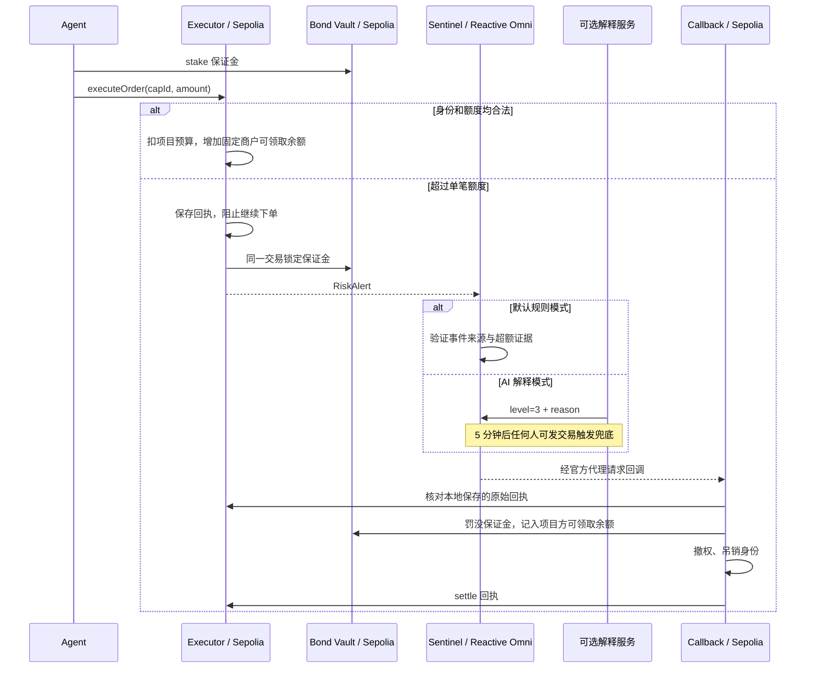

# AgentSentinel：受限付款与跨链违规处置

更新：2026-11-25。

Agent 使用项目方预存的 ETH 向一个固定商户下单。合约检查身份、保证金、授权有效期和单笔额度；超额请求不付款，但留下回执并锁定保证金。Reactive 订阅风险事件，回调源链完成撤权、保证金罚没和身份吊销。AI 可解释这份证据，不能决定是否放过确定性超额。

当前是本地验证过的黑客松原型。本次修改没有重新部署测试网，也没有调用真实 LLM。旧 `deploy_sepolia_core.txt` 不代表这个版本已经部署。

## 实际流程



正常订单的资金结果是商户可领取的 ETH 债权；商户调用 `claimPayment()` 后才实际转账。超额请求不增加商户债权、不扣预算。`RiskAlert` 证明一次被拒绝的请求，不证明损失已经发生。

## 运行验证

三条保护及测试：

| 保护 | 实现 | Foundry 用例 |
| --- | --- | --- |
| 只在该触发时触发 | 仅接受系统调用、指定源链/Executor/topic，且 amount > maxSpend；回调再验证代理、Sentinel 和本地回执 | `testWrongOriginAndMalformedLogsIgnored`、`testCallbackAuthenticatesProxyAndSender` |
| 同一事件只处置一次 | Sentinel.seen 防重复请求，Callback.processed 防重复执行 | `testDuplicateRiskAndCallbackAreIdempotent` |
| 单次和累计金额上限 | 单次不超过授权 maxSpend；Executor.totalSpent 不超过部署时固定的 totalSpendLimit，所有 Agent/授权共用 | `testNormalOrderAtSingleLimitSucceeds`、`testSingleLimitBlocksPaymentAndPreservesEvidence`、`testTotalLimitCannotBeBypassedBySplittingFundingOrNewCapability`、`testTotalLimitIsSharedAcrossAgents` |

累计金额按已经分配给商户的 ETH 计数，领取、充值和重新授权不重置；达到总上限后不能靠充值继续花费。总限额从部署参数 `TOTAL_SPEND_LIMIT_WEI` 读取，单位 wei。

提交材料：[测试代码](test/AgentSentinel.t.sol)、[forge test 截图](docs/evidence/forge-test.jpg)、[测试输出](docs/evidence/forge-test.txt)。当前运行结果为 Foundry 34 passed、0 failed（AgentSentinel 28 项、Bounded Cron 6 项），Node.js 12 passed、0 failed；系统和代理使用测试替身，未广播实网交易。现有截图只覆盖 AgentSentinel 主套件，完整 34 项以全套最新输出为准。

需要 Foundry 和 Node.js 22+，不需要 npm 安装。编译器固定为 Solidity 0.8.35，EVM 目标为 Cancun。

```powershell
cd 'F:\AI\分栏\reactive-builder-camp2026\agentsentinel'
forge test -vv
node --test scripts/ai-verdict.test.js
forge test --match-test testEndToEndFromActualEventAndMerchantPayment -vvvv
```

最后一个命令从 Executor 实际发出的日志构造 Reactive 输入，再经过模拟系统请求和代理交付，检查付款、锁款、撤权、罚没、回执结算和后续订单拒绝。它不替代真实网络交付验证。测试明细和已知边界见 [验证与边界](docs/验证与边界.md)。

## 合约分工

| 文件 | 责任与边界 |
| --- | --- |
| `AgentRegistry.sol` | 项目方登记身份；Revoked 不可恢复，不能清回 None 后重新注册 |
| `CapabilityRegistry.sol` | 单笔额度、有效期和策略标签；不是累计额度或行为模型 |
| `SentinelExecutor.sol` | 真实 ETH 预算与固定商户债权、全局累计支出硬上限、回执存储、同步拦截和待处置阻断 |
| `AccountabilityVault.sol` | 保证金锁定、提款、罚没和项目方领取；余额去向可核对 |
| `AgentSentinel.sol` | 校验链 ID、发件合约、topic、编码和超额关系；去重、解释窗口、回调重试 |
| `SentinelCallbackTarget.sol` | 校验官方代理和 Sentinel 地址，再比对源链回执；原子处置和幂等重放 |

`recipient`、Vault 的 Executor/Slasher、Executor 的 Resolver 只能设置一次。Registry/Capability 的管理员仍能调整身份、授权和处置角色，属于明示的信任边界。

## 链下解释

按 `.env.example` 配置新部署地址、RPC 和 `FROM_BLOCK`。不要用模板覆盖现有 `.env`。

```powershell
# 只读解释；--once 扫描至多 1000 个已确认区块并处理待办
node scripts/ai-verdict.js --once
# 持续读取和生成解释
node scripts/ai-verdict.js
# 只有显式加 --submit 才发送 verdict 交易
node scripts/ai-verdict.js --submit
```

无 API key 时输出 `provider=rules`。模型超时、HTTP 失败、非法 JSON、试图降级或理由过长时，记录规则兜底；不会称为真实 AI 推理。模型参数和证据写入 `.state/explanations.jsonl`，这只是链下记录，不是模型来源的密码学证明。

提交使用 Foundry 加密账户 `CAST_ACCOUNT` 和 `CAST_PASSWORD_FILE`。脚本不读取 `PRIVATE_KEY`，不拼接 shell。`--submit` 的账户必须是 Sentinel owner。

游标与失败待办保存在 `.state/`，解释模式和提交模式使用独立游标。只有成功处理才移除待办。默认等待源链 12 个区块，并在处理前检查原区块哈希；深度重组需要人工核对，确认数不是最终性证明。服务异常退出留下 `.lock` 时，先确认旧进程已经退出，再删除对应锁文件。

## 部署和演示

新版本改变了构造参数和状态布局，不能复用旧部署。按 [部署与演示](docs/部署与演示.md) 分别部署源链、Reactive 合约和回调，再连接角色。这里只提供可检查脚本，不默认广播。

黑客松材料：[完整提交材料](../notes/提交包：可以直接交给黑客松的材料.md)、[Demo Day 完整口播与问答](../notes/Demo%20Day%20展示.md)、[演示幻灯片](docs/demo-day-slides.md)。新版尚未部署，地址、三笔链上交易和演示视频需要实际演示后补齐。发布审查记录见[发布准备与缺口审查](docs/发布准备与缺口审查.md)。

## 出问题怎么办

Executor 的可用预算不足时自动拒绝付款，交易回滚，不产生新债权；项目方调用 `fund()` 并附 ETH 后可重试，但充值不会重置累计支出，达到 `totalSpendLimit` 后仍会拒绝。Reactive/Callback 的费用另算：余额与费用储备耗尽、产生欠费后，网络会停止执行；向 Reactive 系统合约或目标链回调代理调用 `depositTo(address)`，传入对应 Sentinel/Callback 地址并附原生币，先清偿欠费、再补储备，检查 `debt(address)=0` 后恢复服务。仅向欠费合约直接转币不保证恢复，费用机制见 [官方说明](https://dev.reactive.network/economy)。

请求回调失败会保留 open 告警；修复或充值后调用 `dispatchExpired(receiptId)`（AI 模式需等待 300 秒）重试。目标链回调失败时，撤权、罚没和结算一起回滚，保证金继续锁定；修复配置或补足费用后，由 owner 在上次请求 60 秒后调用 `retryDispatch(receiptId)`。失败仍可能消耗网络费，重试不是自动发生的；目标端按回执去重，最后以 `processed=true` 和源链回执 `settled=true` 判断完成，不能只看 `Dispatched`。

## 项目能证明什么

项目展示的是：局部同步拦截 + 可核对证据 + Reactive 异步处置 + 失败恢复。它只保护进入 Executor 的资金；没有接入任意 EOA、Safe、DEX、ERC-20 或其他链上的资产。

单链单商户场景可以用普通合约一次完成撤权，Reactive 并不是这一场景的必要条件。保留 Reactive 是为了验证独立事件驱动处置链路；多链权限同步目前只是后续假设。项目价值、替代方案和答辩边界见 [项目论证](docs/项目论证.md)。

本版移除了无业务结果的 Cron 心跳及没有完整策略支持的 L0/L1/L2 处置入口。到期授权在下一次操作时被拒绝，不宣称到期时自动运行交易。

## 定时任务实验

`BoundedCronReactive` 是独立的 Cron100 练习，不属于 AgentSentinel 资金处置路径。Reactive 合约只接受 Lasna 的 Cron100 日志，每次最多请求一次目标链回调；部署时固定 `CRON_MAX_RUNS`，达到上限自动退订，也可由 owner 提前停止。目标链 `BoundedCronCallback` 校验 Callback Proxy 和 Reactive 地址，并按序号去重。

```powershell
forge test --match-path test/BoundedCron.t.sol -vv
```

部署脚本在 `script/DeployCron.s.sol`，分为 Lasna 部署 Reactive、目标链部署 Callback、回 Lasna 设置目标并启动订阅三步。配置项为 `CRON_DESTINATION_CHAIN_ID`、`CRON_MAX_RUNS`、`CRON_REACTIVE_FUNDING_WEI`、`CRON_CALLBACK_PROXY_ADDR`、`CRON_REACTIVE_ADDR`、`CRON_CALLBACK_FUNDING_WEI` 和 `CRON_CALLBACK_ADDR`。费用分属 Lasna Reactive 执行和目标链回调；次数上限限制交易次数，不能保证网络费用不会耗尽。当前只有本地替身测试，没有部署地址或真实触发交易。
