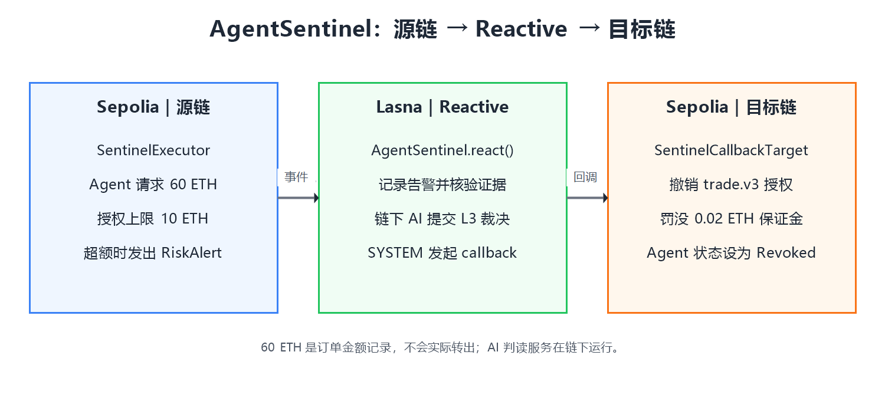

# D1 Use Case：AgentSentinel 跨链处置

## 1. 监听什么

源链是 Sepolia。`SentinelExecutor` 记录 Agent 的操作金额，并读取该 Agent 的授权上限。金额超过上限时，合约发出 `RiskAlert` 事件。

示例中 Agent 请求 60 ETH，授权上限是 10 ETH，因此会发出告警。这里记录的是模拟订单金额，不会真的转出 60 ETH。

## 2. 什么条件会触发

当 `RiskAlert` 到达 Lasna 上的 `AgentSentinel`，Reactive Network 调用它的 `react()`。合约记录告警，链下 AI 判读服务根据事件和授权上下文提交 level 3 裁决。

`AgentSentinel` 会再检查链上证据：只有请求金额确实大于授权上限，才接受 level 3 裁决并发起回调。AI 给出判断，链上规则负责把关。

## 3. 在哪条链做什么

目标链还是 Sepolia。SYSTEM 投递 callback 后，`SentinelCallbackTarget` 执行三项处置：撤销 `trade.v3` 能力授权、罚没 0.02 ETH 保证金、将 Agent 状态改为 `Revoked`。

## 4. 不用 Reactive 会怎样

需要自己运行一个链下服务，持续监听 Sepolia 的 `RiskAlert`，调用 AI，再签名发送交易提交裁决，并继续负责重试、管理 nonce 和支付 gas。服务停机或 RPC 断开时，告警可能无法及时处理。

Reactive 可以根据订阅事件自动调用 Lasna 上的 `react()`，并通过 callback 把处置请求送到 Sepolia，减少自己维护事件监听和跨链投递的工作。代价是 Reactive 执行要有 lREACT，目标链 callback 要有 Sepolia ETH；AI 判读服务仍需链下运行。

## 简单理解

把它想成跨链烟雾报警器：Sepolia 的执行合约发现 Agent 超额操作后发出警报；Lasna 收到警报并核验证据；确认违规后，callback 回到 Sepolia 关掉权限、扣除保证金并吊销身份。

## 流程图

