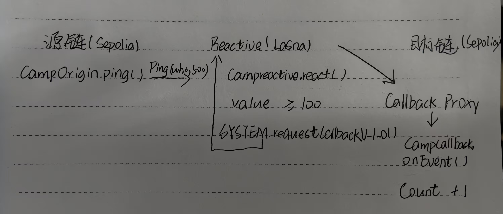

# 跨链事件触发目标链记录

## 知识点

Reactive 订阅源链事件

事件满足条件后调用 `react()`

通过 Callback Proxy 在目标链调用合约

## 思路

1. **监听什么**：监听 Ethereum Sepolia 上 `CampOrigin` 发出的 `Ping(address,uint256)` 事件。

2. **什么时候触发**：`CampReactive` 收到事件后读取 `value`。小于 100 时不请求回调；本次 `ping(500)` 发出的值是 500，满足条件。

3. **目标链做什么**：目标链还是 Sepolia。Lasna 上的 `CampReactive` 通过 SYSTEM 请求回调后，Sepolia 的 Callback Proxy 调用 `CampCallback.onEvent()`。Callback 记录事件，把 `count` 加一，并保存这次的 `value`。

4. **不用 Reactive 怎么做**：自己运行一个机器人持续监听 Sepolia 的 `Ping` 事件。发现 `value >= 100` 后，再由机器人向 Sepolia 的 Callback 合约发交易。机器人需要一直在线，也要管理钱包、gas、重试和 RPC。Reactive 接手事件订阅和触发回调；代价是 Lasna 执行和目标链回调都需要费用，而且跨链调用要等待两边处理。

## 流程

```text
Sepolia：钱包调用 CampOrigin.ping(500)
    → CampOrigin 发出 Ping(who, 500)
    → Reactive 网络匹配订阅事件，调用 Lasna SYSTEM
    → CampReactive.react(log)，检查 value >= 100
    → CampReactive 调用 SYSTEM.requestCallbackV_1_0(...)
    → Sepolia Callback Proxy 调用 CampCallback.onEvent(...)
    → count 加一，保存 value=500
```

手绘的流程图：



这次完整调用的三笔交易：

- 源链发出 `Ping(500)`：[Sepolia 交易](https://sepolia.etherscan.io/tx/0xa76ece4dce856b1be94d7978b1413416192a908fbe91ffb0cfcb963954b73997)
- Reactive 执行 `react()`：[Lasna 交易](https://lasna.reactscan.net/tx/0x00c072c3a3966e0965c9c168e72d6f66fd4b65ff9c60d9b036f54ef3a7d04082)
- 目标链执行 Callback：[Sepolia 交易](https://sepolia.etherscan.io/tx/0xb5f0ce08692130235aa5e6c2b0bbf013aa38cb58aada7e7e1f55840b24d09d41)

实际结果是 Callback 的 `count` 从 0 变成 1，`lastValue` 是 500。Callback 只允许 Callback Proxy 和指定的 Reactive 合约触发。

## 收获

这个实例展示了 Reactive 适合处理的情况：一条链上的事件满足条件后，需要自动触发另一条链上的合约。

Reactive 帮忙监听和转发调用，但源链事件、Reactive 执行、目标链回调是分开的步骤，不是同一笔同步交易。

日期：2026-11-23
