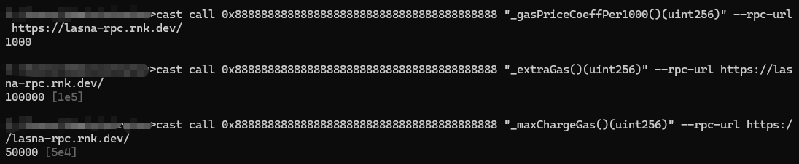

# Reactive 费用

Reactive 流程分两段计费：

- Reactive 链执行 `react()`，使用 lREACT 结算。
- 目标链执行 callback，使用目标链原生币结算，例如 Ethereum 上的 ETH。

## 余额、储备和欠费

合约余额是合约地址持有的资金；`reserves` 是预存到 SYSTEM 或 callback proxy 的费用额度；`debt` 是尚未结清的费用。扣费先使用 reserves，不足时才产生 debt。只要 debt 大于 0，网络就会暂停调用 `react()` 或投递 callback。

向 SYSTEM 调用 `depositTo(address)` 会先偿还目标合约的 debt，再把剩余金额记入 reserves。直接转账到合约地址只增加合约余额，不会自动清偿 debt。合约若实现并开放 `coverDebt()`，也可以从自己的余额偿还。

## 费用计算

费用公式：

```text
fee = p_base × C × (g_used + K)
```

其中 `g_used` 是执行消耗的 gas，`K` 是附加 gas。当前实验里一次 `react()` 的费用约为 0.0138 lREACT，实际费用会随执行内容和网络参数变化。

过滤不需要处理的事件时，在 `react()` 中直接 `return`。`revert` 仍会收费，反复回滚会消耗余额并可能让合约因欠费停机。

## Lasna SYSTEM 参数

使用 Foundry `cast` 通过 Lasna RPC 读取 SYSTEM 合约 `0x8888888888888888888888888888888888888888` 的费用参数：

```powershell
cast call 0x8888888888888888888888888888888888888888 "_gasPriceCoeffPer1000()(uint256)" --rpc-url https://lasna-rpc.rnk.dev/
cast call 0x8888888888888888888888888888888888888888 "_extraGas()(uint256)" --rpc-url https://lasna-rpc.rnk.dev/
cast call 0x8888888888888888888888888888888888888888 "_maxChargeGas()(uint256)" --rpc-url https://lasna-rpc.rnk.dev/
```

输出依次为 `1000`、`100000` 和 `50000`。其中系数按千分比计，实际计算时除以 1000；`_extraGas` 是固定附加 gas；`_maxChargeGas` 是 SYSTEM 调用 `pay()` 结算费用时允许使用的 gas 上限。



图中是使用 `cast call` 读取上述三个参数的终端输出。

记录日期：2026-11-17


